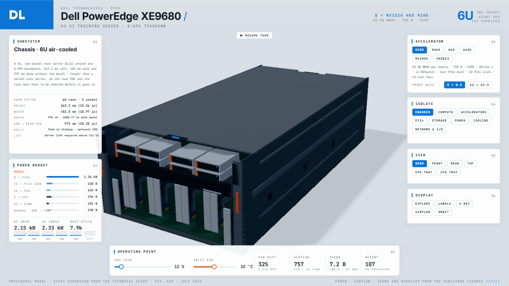
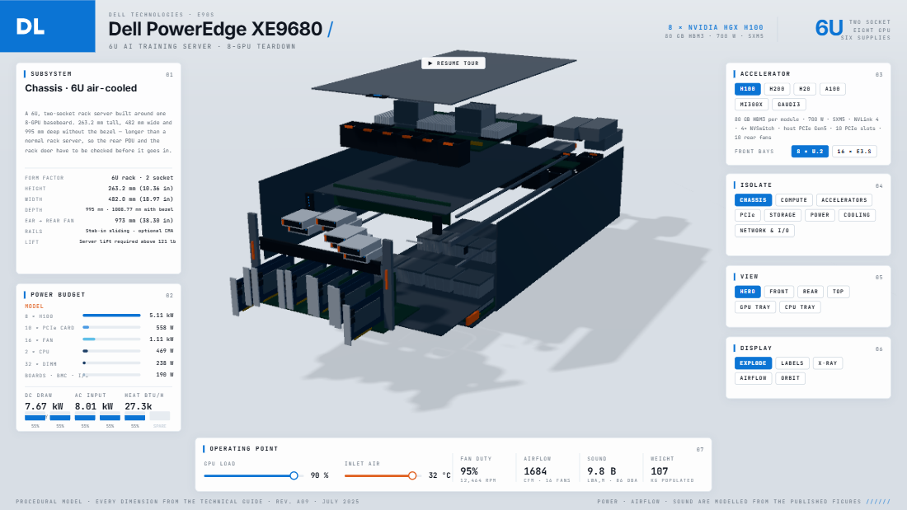
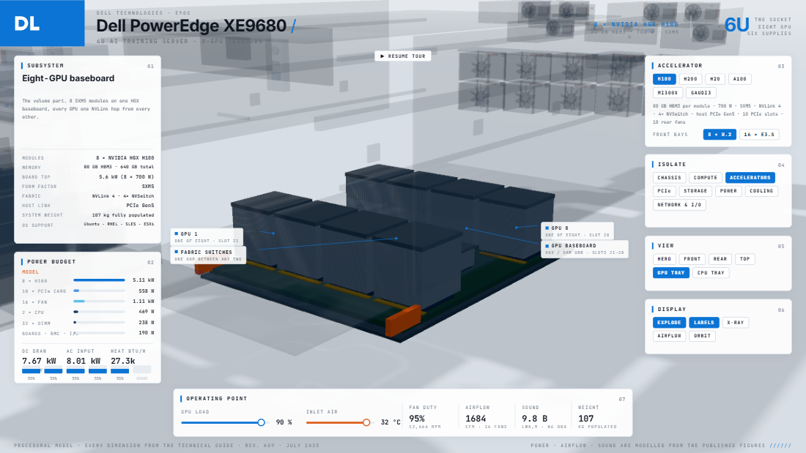
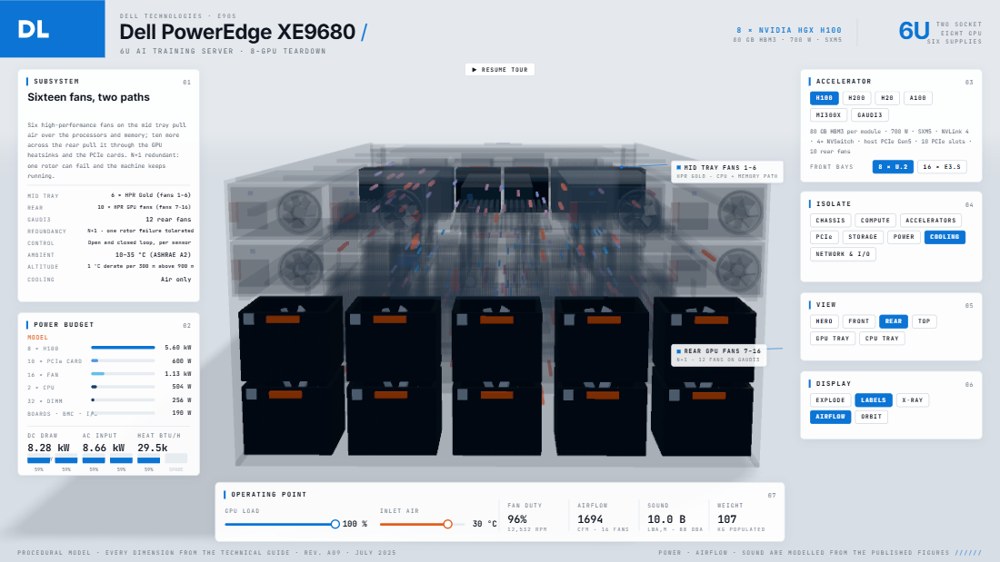
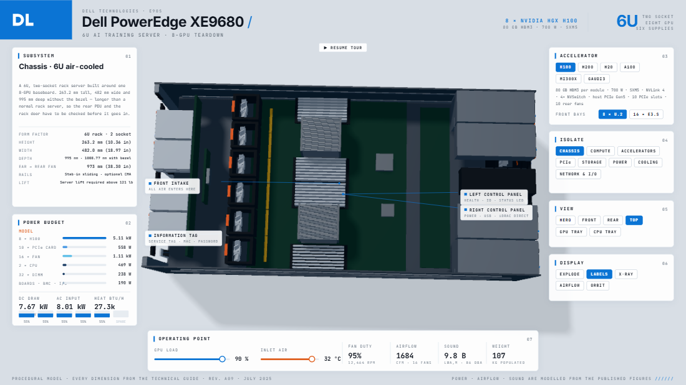

# Dell PowerEdge XE9680 — Interactive 3D Teardown

An interactive 3D teardown of Dell's 6U, two-socket, eight-GPU AI training server, built as **one
offline HTML page**. Pick a subsystem and the rest of the machine goes to a ghost; pull the camera
around it; take the whole thing apart; swap the accelerator and watch the fan count, the slot count,
the weight and the power budget change with it.

Every dimension, slot number, part count and rating comes from the
**Dell PowerEdge XE9680 Technical Guide, Regulatory Model E90S, Rev. A09, July 2025**, held in one
file (`xe9680/spec.js`) that the geometry, the panels and the model all read from — so nothing on
screen can disagree with anything else on screen.

**[→ Open the page](index.html)** · **[→ Component breakdown (ภาษาไทย)](docs/components.md)**



---

## What you can do

| Control | |
|---|---|
| **ISOLATE** | Chassis · Compute · Accelerators · PCIe · Storage · Power · Cooling · Network & I/O — the chosen subsystem stays solid, everything else fades to a pale ghost, and the left card fills with that subsystem's specifications |
| **VIEW** | Hero · Front · Rear · Top (the lid slides off) · GPU tray · CPU tray |
| **DISPLAY** | Explode · Labels · X-ray · Airflow · Orbit |
| **ACCELERATOR** | H100 · H200 · H20 · A100 · MI300X · Gaudi3 — changes the GPU modules, the rear fan count (10 → 12 on Gaudi3), the available PCIe slots (10 → 8), the system weight and every number in the power model |
| **FRONT BAYS** | 8 × U.2 or 16 × E3.S (greyed out on Gaudi3, which does not support it) |
| **OPERATING POINT** | GPU load and inlet air temperature — the two inputs that drive the fan speed, the airflow, the power budget and the sound level |
| Mouse | Drag to orbit · wheel to zoom |
| Keys | `1`–`6` views · `e` explode · `l` labels · `x` x-ray · `a` airflow · `o` orbit · `[` `]` cycle accelerator · `space` tour |

Left alone, the page plays a 54-second tour of itself with an operator's cursor. Any click, drag,
wheel or key hands control over; 22 seconds of quiet hands it back.

---

## What is modelled, and what is measured

The panels mark computed values **MODEL**. Everything else is read straight from the guide.

* **From the guide** — chassis dimensions, slot numbering and riser mapping, processor SKUs, memory
  rules, drive configurations, PSU ratings and efficiency curve, fan counts, acoustic measurements,
  environmental limits, weights.
* **Modelled from those numbers** — the power budget per subsystem, the PSU load and AC input, the
  heat in BTU/hr, the fan duty and RPM, the airflow in CFM, and the sound level interpolated between
  the guide's measured points. The formulas are listed in
  [`docs/components.md` §12](docs/components.md) and live in `xe9680/spec.js`.

One input drives everything: change the GPU load slider and the fans spin faster on screen, the
streaks move quicker, the watts climb, the supplies load up and the sound level rises — all from the
same function.

---

| | |
|---|---|
|  |  |
| Exploded: lid, CPU tray, GPU tray, cards, supplies and fans | The eight-GPU baseboard isolated — 8 modules, 4 fabric switches |
|  |  |
| The rear fan wall with the airflow on, cool at the front to warm at the back | From above with the lid slid off: drives, mid-tray fans, the board, the supplies |

---

## The machine, briefly

```
                  ┌──────────────── 995 mm ────────────────┐
   upper deck     drives │ fans 1–6 │   2 × Xeon + 32 DIMM  │ 6 × PSU + I/O
   lower deck     10 × PCIe Gen5     │   8-GPU baseboard     │ fans 7–16
                  front ──────────────── air ──────────────► rear
```

Two separate air paths — one over the processors, one through the GPU heatsinks — are what let eight
900 W modules be cooled with air in a 6U box. The full breakdown is in
**[docs/components.md](docs/components.md)**.

---

## Build it yourself

```bash
npm install
npm run build
```

That bundles `xe9680/main.js` with three.js and both fonts into a single `index.html` (~780 KB) that
opens from `file://` and needs no server. `npm run dev` does the same unminified.

### Source layout

| File | Job |
|---|---|
| `xe9680/spec.js` | Every published number, plus the power/thermal/acoustic model. The single source of truth. |
| `xe9680/server.js` | The machine as geometry, built from code in millimetres in the chassis frame. One group per subsystem, each with its own materials and explode vector. |
| `xe9680/stage.js` | Renderer, studio lighting, shadows, GTAO, bloom. `frame(state, cam)` draws one frame. |
| `xe9680/console.js` | The overlay: a fixed 1600 × 900 layout of panels, buttons, sliders and callouts. |
| `xe9680/tour.js` | The six camera views and the script the auto tour plays. Pure functions of time. |
| `xe9680/live.js` | Interaction: buttons, sliders, orbit, zoom, keys, the quality tiers and the tour handover. |
| `xe9680/warm.js` | Compiles every shader in parallel before the first frame. From [claude-motion](https://github.com/whaleyxbt/claude-motion) (MIT). |
| `build.mjs` | The bundler. |

Runs at 60 fps at 1600 × 900 and 56 fps in its heaviest state (exploded, airflow on, labels on).
Three quality tiers drop AO, shadow resolution and pixel ratio automatically if frames start to slip,
so it stays usable on integrated graphics and on a phone in landscape.

---

## Notes and credits

* Built with [three.js](https://threejs.org/) 0.186 and bundled with [esbuild](https://esbuild.github.io/).
* `xe9680/warm.js` is from [whaleyxbt/claude-motion](https://github.com/whaleyxbt/claude-motion) (MIT).
* This is an independent, unofficial visualisation for study and explanation. Dell, PowerEdge and
  XE9680 are trademarks of Dell Inc.; NVIDIA, HGX, H100, H200, H20 and A100 of NVIDIA Corporation;
  Instinct and MI300X of Advanced Micro Devices, Inc.; Xeon and Gaudi of Intel Corporation. Not
  affiliated with or endorsed by any of them.
* Geometry is modelled to the published external dimensions and the chassis views in the technical
  guide. Internal part shapes are representative, not a mechanical drawing — this is a teaching
  model, not a service manual. For installation and service, use the official
  *PowerEdge XE9680 Installation and Service Manual*.

MIT licensed — see [LICENSE](LICENSE).
